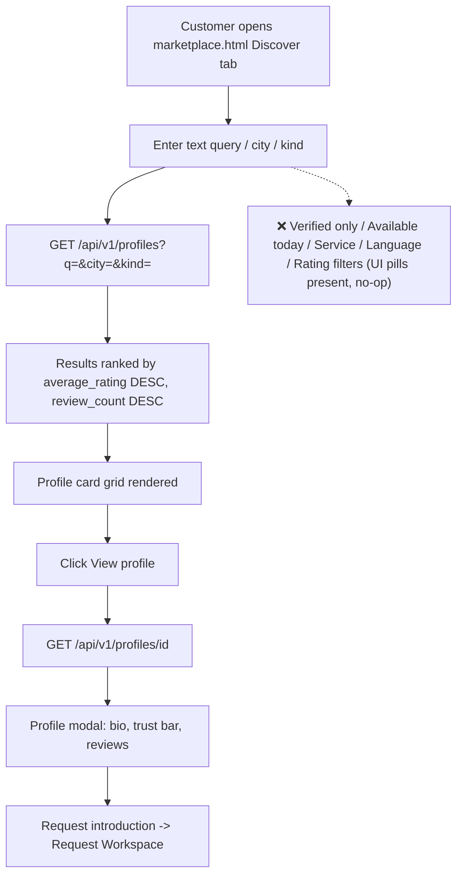

# 2. Discover / Marketplace Search

Status: 🟡 Partial

## Workflow

## Completed

- `GET /api/v1/profiles?q=&city=&kind=` — text search over name/headline, case-insensitive city match, kind filter (`expert`/`company`), sorted by rating and review count ([service.py](../../backend/app/features/marketplace/service.py)).
- `GET /api/v1/profiles/{profile_id}` — full detail incl. bio, services, and reviews with reviewer names/ratings.
- Data model: [profile.py](../../backend/app/models/profile.py) — `profiles`, `organizations`, `services`, `profile_services`, denormalized `average_rating`/`review_count`.
- Seed data: [seed.sql](../../db/seed.sql) — 3 services, 3 verified profiles with sample reviews for demoing.
- Frontend: [marketplace.html](../../frontend/pages/marketplace.html) — search panel, results grid with rating/review/response-time, profile preview modal, insights sidebar (top matches, verified review count, avg response time).

## Not Done / To Do

- Some search filters are still UI-only placeholders with no effect: **"Any location"**, **"Verified only"**, **"Available today"** pills.
- No service filter (`?service=slug1,slug2`), language filter (`?languages=`), experience range, or rating threshold — schema supports it but query params/service logic don't exist.
- No **saved profiles / comparison list** — see [10-backlog.md](10-backlog.md).
- No **recommendations** based on stored customer `interests` beyond the last search term auto-fill — see [10-backlog.md](10-backlog.md).

## Recently Completed (Sept 2026)

- `GET /api/v1/profiles` now supports `page`/`page_size` and returns them in the response ([router.py](../../backend/app/features/marketplace/router.py), [service.py](../../backend/app/features/marketplace/service.py)).
- Discover's kind select was replaced with **Experts/Companies toggle pills** (`#kind-toggle`), both checked by default, plus Prev/Next pagination controls in [marketplace.html](../../frontend/pages/marketplace.html).

## Video showcases (November 2026)

- Discover includes a horizontally scrollable row of the latest 8 showcases. **View all showcases** opens the dedicated paginated section, also reachable from the sidebar or `marketplace.html?view=showcases`.
- Each card shows a cover, title, description, provider profile action, original-platform watch link, and support-based reporting. Videos open on YouTube/Instagram; RightConnect does not download, embed, or stream them. These are provider-posted promotions, not verified endorsements or paid placements.
- Expert profile owners and company **admins** can publish, edit, and remove their own profile's showcases. Customers and company staff cannot publish. Management is available from the full showcase section, the owner's public profile, and the profile editor.
- Free profiles may publish **2** showcases; an expert's active **Pro** plan or a company's active **Enterprise** plan permits **10**. Limits are per profile, not per login. Mutations lock the profile row to serialize concurrent submissions. Existing posts stay published after plan expiry; adding another requires being below the current limit. Editing/removing existing posts remains possible.
- The preview endpoint validates and canonicalizes supported YouTube Shorts, YouTube watch/short links, and Instagram `/reel/` links without fetching the submitted URL. YouTube thumbnail URLs are derived from the video ID. Instagram requires an uploaded thumbnail/poster; no scraping or Meta integration is used. Titles and descriptions are entered by the provider.
- Failed or tiny YouTube placeholder thumbnails prompt an upload. JPG/PNG/WebP input is limited to 8 MB and converted to WebP (longest side up to 960 px, output up to 1 MB) through the existing Supabase Storage image helper. Images keep their full aspect ratio inside the card; no crop is applied. Uploads use the authenticated user's folder and randomized `showcase-<uuid>.webp` names in the existing `profile-images` bucket.
- The API accepts only the generated thumbnail for that video or an image uploaded under the authenticated user's showcase path. An editor can retain a stored cover originally uploaded by another company admin. Unavailable public card images show a clear placeholder while the external watch link stays usable.
- Blocked/deleted profiles, deleted/blocked expert owners, and deleted companies are excluded from public listings. Reports open the existing support channels with the showcase/profile identifiers and video link; admins can use existing profile moderation to hide the provider's content.

### Storage and release

Apply [migration 022](../../db/migrations/022_video_showcases.sql) to existing databases **before** deploying the API. Fresh projects use [schema.sql](../../db/schema.sql), which includes the table, indexes, and RLS. Existing projects also need [image storage migration 018](../../db/migrations/018_profile_image_storage.sql) if not already applied. Browser database access is revoked; reads/writes go through FastAPI.

Removing a showcase removes its database row, not the original video. Uploaded cover files are public and are not automatically deleted by editing/removing a post; operators must include unused showcase covers in storage-retention/deletion handling. The feature makes no claim that an external video is still public or playable.

Code: [feature API](../../backend/app/features/showcases/), [ORM](../../backend/app/models/showcase.py), [frontend](../../frontend/assets/showcases.js).

Run dependency-free regressions with `python3 -B -m unittest discover -s backend/tests -p 'test_showcases.py' -v`. These exercise actual link parsing and isolated service/ownership function bodies with mocked database boundaries; they do not replace FastAPI/PostgreSQL/Supabase integration tests. Frontend syntax checks are included in [public-entry tests](../../frontend/tests/test_public_entry.py). Before release, test real sign-in, free/paid limits, simultaneous publishing at the limit, storage permissions, upgrade/expiry behavior, and mobile scrolling on staging.
