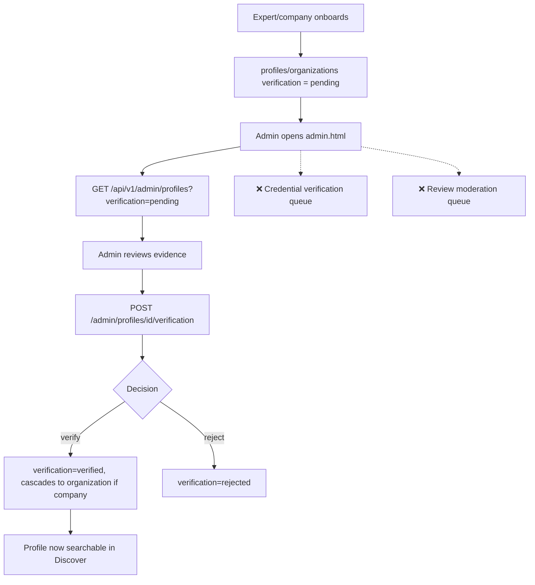

# 5. Admin Verification Console

Status: 🟡 Partial

## Workflow

## Completed

- `GET /api/v1/admin/profiles?verification=pending|verified|rejected` — list profiles by status, `platform_admin`-only ([router.py](../../backend/app/features/admin/router.py)).
- `POST /api/v1/admin/profiles/{profile_id}/verification` — approve/reject; cascades to the linked `organization` when the profile is a company.
- Access control via `require_platform_admin()` in [security/dependencies.py](../../backend/app/security/dependencies.py), gated on `users.role == platform_admin`.
- Frontend: [admin.html](../../frontend/pages/admin.html) — Pending/Verified/Rejected tabs, profile cards, verify/reject buttons.
- Company listings & claims: **+ Add business** creates an unclaimed company listing, the **Unclaimed** profile filter lists them, and the **Claims** tab approves or rejects ownership claims (with a pending-count badge). See [06-company-features.md](06-company-features.md#unclaimed-listings--ownership-claims-november-2026).

### Leads (November 2026)

For enquiries that came in from ads (mostly WhatsApp) but haven't signed up. Admin-only, in the console's **Leads** tab ([admin/index.html](../../backend/admin/index.html)); API under `/api/v1/admin/leads` ([leads/](../../backend/app/features/leads/)), table `leads` (migration [032_leads.sql](../../db/migrations/032_leads.sql)).

- **Fields:** phone/WhatsApp (required, one lead per number, stored as `+91…`), name, type (company / expert / worker / customer / not sure), company or shop name, work/service, city, source (e.g. "WhatsApp ad – Nov 2026"), status (New, Contacted, Interested, Follow-up, Not interested, Signed up), follow-up date and notes.
- **Profile created?** Each lead shows **✓ Profile** or **No profile yet**. This is checked live against RightConnect accounts (`users.phone`), worker profiles, company listings (`organizations.contact_phone`) and expert/company contact numbers. Filter **No profile yet** to get the people still to pitch. Numbers only match when stored the same way (`+91` + 10 digits).
- **Paste from Excel / Google Sheets:** copy rows (with or without a header) and paste. The page guesses which column is the phone, name, type, shop, city, notes and so on; you can change each column before importing. Phones like `98765 43210`, `+91-98765-43210`, `919876543210`, `09876543210` or `9876543210.0` are accepted. Type and status are read from words like "shop owner", "driver", "consultant", "call back" and "not interested". Dates are read day first (05/12/2026). A number that is already a lead (or repeated in the paste) only fills that lead's empty fields and adds new notes; nothing entered is overwritten. Rows without a valid phone are listed after the import. Up to 2000 rows are sent per request.
- **Working the list:** change status from the dropdown on each lead. **WhatsApp** opens a ready pitch for the lead's type, with the sign-up link, and marks a New lead Contacted. Pills: All, **Due today** (follow-up date today or earlier, not signed up or not interested; also shown as a count on the tab), and each status. Filter by type and profile, and search name/phone/shop/city/notes.
- **Download for Excel:** saves what's on screen as a CSV (UTF-8 with BOM so Tamil names show correctly; phone kept as text). Cells starting with `=`, `+`, `-` or `@` get a `'` so they can't run as formulas.
- Leads are only tracked here; profiles are not created automatically. Use **+ Add business** / **+ Add worker** for that.

## Not Done / To Do

- Admin console only covers **profile verification** — there is no queue for:
  - `credentials` (table exists in [schema.sql](../../db/schema.sql), no endpoints at all — see [07-expert-profiles.md](07-expert-profiles.md))
  - review moderation (see [04-reviews-trust.md](04-reviews-trust.md))
  - disputes (see [10-backlog.md](10-backlog.md))
- `admin.html` has **no built-in login/role check** in the page itself; it relies on the signed-in Supabase session already having `platform_admin` role — worth hardening (redirect/guard on load, not just server-side 403s).
- No audit trail of who verified/rejected a profile and why (no `verified_by`, `verified_at`, `rejection_reason` columns).
