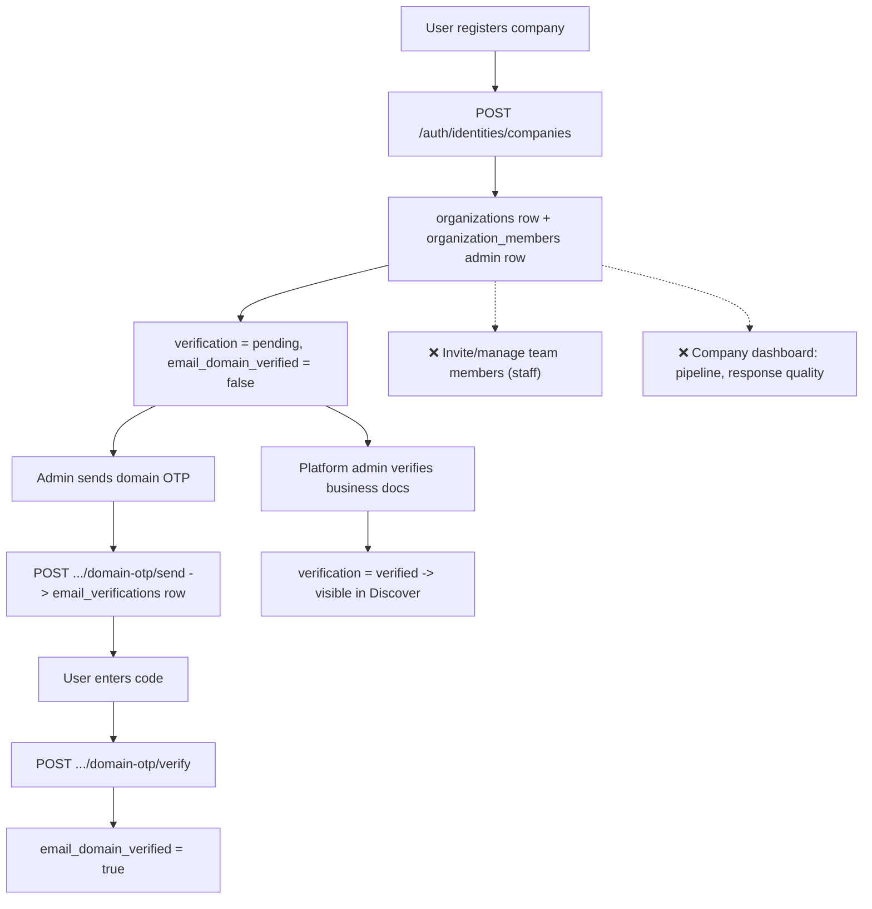
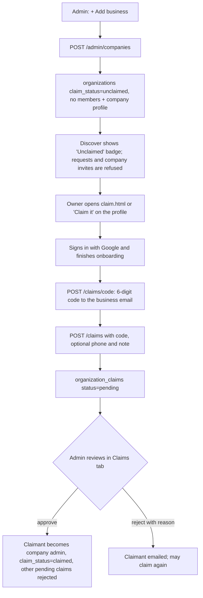

# 6. Company Features

Status: 🟡 Partial

## Workflow

## Completed

- `POST /api/v1/auth/identities/companies` — registers a new company; caller becomes first `admin` member.
- `POST /api/v1/auth/identities/companies/domain-otp/send` and `/verify` — 6-digit email OTP flow (10 min TTL, 5 attempts, SHA-256 hash) proving control of the company's email domain.
- `GET /api/v1/auth/identities` — lists all companies a user administers/staffs.
- Data model: [organization_member.py](../../backend/app/models/organization_member.py) (`member_role`: admin/staff, unique per org+user), `organizations` in [profile.py](../../backend/app/models/profile.py) (slug auto-generated, `email_domain_verified`, `subscription_tier`).
- Frontend: [marketplace.html](../../frontend/pages/marketplace.html) workspace switcher — lists companies the user administers, "Register company" modal.

## Unclaimed listings & ownership claims (November 2026)

Platform admins can add real local shops and consultancies before their owners join. Only **company** listings can be unclaimed; expert profiles are always created by the person themselves.

- Public endpoints ([claims/router.py](../../backend/app/features/claims/router.py)): `GET /api/v1/claims/listings?q=&city=`, `GET /api/v1/claims/listings/{profile_id}`, `GET /api/v1/claims/mine`, `POST /api/v1/claims/code`, `POST /api/v1/claims`.
- Admin endpoints ([admin/router.py](../../backend/app/features/admin/router.py)): `POST /api/v1/admin/companies`, `GET /api/v1/admin/claims?status=pending|approved|rejected|all`, `POST /api/v1/admin/claims/{id}/approve`, `POST /api/v1/admin/claims/{id}/reject`; `GET /admin/profiles?verification=unclaimed`.
- Rules: claim codes reuse `email_verifications` (`purpose='company_claim'`, 10-minute TTL, 5 attempts, max 3 codes per email per 10 minutes and 10 per listing per hour). A claim is flagged **email matches listing** when the proven email equals the admin-entered contact email or is on the website's own domain (free-mail domains never match). One account can still run only one company. Approval locks the organization row, so two claims can't both win. Approval/rejection emails are best-effort; the decision is saved even if email isn't configured.
- Privacy: `contact_email`/`contact_phone` are admin-only and never returned by public endpoints. Unclaimed listings stay out of the admin "Pending verification" queue.
- Frontend: [claim.html](../../frontend/pages/claim.html) (find → sign in → prove email → submit → track claims), "Unclaimed" badge and "Claim it" link in [marketplace.html](../../frontend/pages/marketplace.html), Claims tab and "+ Add business" form in the [admin console](../../backend/admin/index.html). `auth.html?return=claim` brings new sign-ups back to the claim page.
- Data: [organization_claim.py](../../backend/app/models/organization_claim.py), `organizations.claim_status/contact_email/contact_phone/claimed_at`; migration [023_company_claims.sql](../../db/migrations/023_company_claims.sql).
- Regression: `PYTHONPATH=backend python3 -B -m unittest discover -s backend/tests -p 'test_company_claims.py' -v`.
- Not done: bulk CSV import of listings, an admin "release ownership" action, and editing an unclaimed listing's contact details after creation.

## Not Done / To Do

- **No team management endpoints** — `organization_members` table supports `staff` role but there is no way to invite, list, change role, or remove members:
  - `GET /organizations/{org_id}/members`
  - `POST /organizations/{org_id}/members` (invite by email)
  - `PATCH /organizations/{org_id}/members/{member_id}` (role change)
  - `DELETE /organizations/{org_id}/members/{member_id}`
- **No company dashboard** — request pipeline by stage, team size, response-quality metrics (see [08-dashboards.md](08-dashboards.md)).
- No company profile editing (name, description, website, city) after creation.
