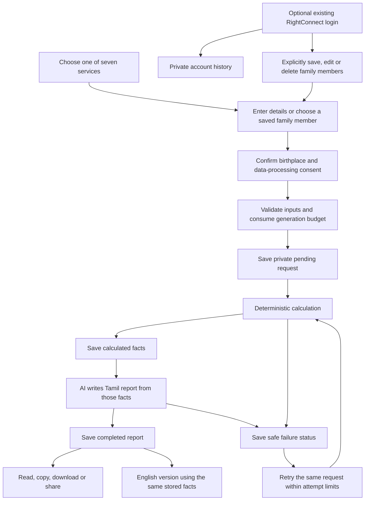

# Tamil Jothidam & Kalaigal AI Reports

## Scope and Isolation

Catalogue: `/pages/services.html`. First working service page: `/pages/thirumana-porutham.html`.
Each service has its own URL; six individual pages are currently marked as coming later.
API: `/api/v1/ai-reports`.
The feature owns its tables, frontend assets, calculation modules and writer.
The only existing runtime integrations are additive settings and one router registration.
Marketplace requests, reviews, subscriptions and Razorpay behavior are unchanged.
All AI services accept only the free `basic` tier.
Generation is disabled by default. A disabled catalogue can be viewed without a database.

### Thirumana porutham (released)

Rasi matching (12 checks) is free. Kattam matching runs fully in the browser and does not need the AI API.
Its section 1 recomputes the 12 poruthams from each person's calculated Moon Rasi/Nakshatra (no extra input).
The verdict and that section are a free preview; dosha and later sections are blurred and replaced with filler text.
A one-time guest Razorpay payment (`RAZORPAY_KATTAM_REPORT_AMOUNT_PAISE`, default 9900 = ₹99) unlocks the
report and downloads an A4 PDF (vendored html2canvas 1.4.1 + jsPDF 2.5.2, rendered client-side so Tamil text shapes correctly).
Endpoints: `GET /api/v1/payments/kattam-report`, `POST .../order`, `POST .../verify`. No login, database row or
migration; orders carry `rightconnect_product=kattam_report` notes and the plan webhook ignores them. Birth details
never leave the browser. The unlock is remembered per tab (sessionStorage SHA-256 of birth data) only.
Because calculation is client-side, a technical user could bypass the paywall; moving the paid sections server-side is required to prevent that.

## User Flow



Guests need no account. A browser-generated 256-bit capability authorizes their
report; only its SHA-256 hash is stored in PostgreSQL. The browser keeps the
capability and report ID in sessionStorage, never birth details. Guest recovery
is limited to that browser tab: download the report before closing it. No
emailed recovery or public report links exist yet. Sharing sends report text,
not an access token. Login does not silently claim older guest reports.

Signed-in generation attaches reports to the existing active RightConnect
account. Account history is available across devices. Family records require
separate explicit consent, are never automatically saved from a report, and
can be selected in birth-detail forms. Existing account onboarding must be
complete before authenticated family/history endpoints can be used; brand-new
users currently complete registration at `/pages/auth.html`. A dedicated
report-only signup experience is future work.

## Module Map

| File / directory | Responsibility |
| --- | --- |
| `backend/app/features/ai_reports/contracts.py` | Strict common inputs and structured report contract |
| `modules/horoscope.py` | Rasi, Nakshatra, Pada, Lagnam and planetary measurements |
| `modules/numerology.py` | English-spelling Pythagorean name and life-path arithmetic |
| `modules/compatibility.py` | Twelve explicit traditional Porutham checks |
| `modules/vastu.py` | Direction-based layout checklist |
| `modules/gemstone.py` | Traditional planetary associations and current mahadasa |
| `modules/baby_names.py` | Nakshatra/Pada syllables and curated Tamil names |
| `modules/forecast.py` | Daily or seven-day dated Panchangam/transit snapshots |
| `astrology.py` / `rules.py` | Shared astronomical engine and versioned cultural conventions |
| `registry.py` | Stable service keys and service discovery |
| `writer.py` | Shared, replaceable OpenAI-compatible JSON report provider |
| `service.py` / `access.py` | Storage, ownership, budgets, generation lifecycle and retries |
| `router.py` | Thin HTTP endpoints and bounded request bodies |
| `backend/app/models/ai_report.py` | New report, family-member and usage tables |
| `frontend/pages/services.html` | Isolated accessible page shell |
| `frontend/assets/ai-reports.js` / `.css` | Tamil/English forms, account state and report renderer |

Every service exposes `input_schema`, `calculate(inputs) -> raw_data`, and
`generate_report(raw_data, language="ta") -> WrittenReport`. Each service owns
its section template. The writer combines that template with service-specific
guidance. `WrittenReport` contains a title, ordered heading/body sections, and a
fixed application disclaimer. Responses are rendered as text, never AI HTML.

To add a service: implement that interface, register it in `SERVICES`, add its
writer guidance and frontend form descriptor, then add calculation/schema tests.

## Calculation Boundaries

- Sidereal Lahiri positions use Swiss Ephemeris with its Moshier engine; no
  downloaded ephemeris files are required. Whole-sign houses are recorded.
- Coordinates and IANA timezone are explicit. City presets are approximate city
  centres, not geocoding. Unknown birth time is not guessed. Ambiguous/nonexistent
  DST times are rejected. Historical timezone conversion uses Python zoneinfo.
- Numerology uses A-Z English spelling, direct digit sums and preserved master
  numbers 11/22/33. Other numerology traditions may differ.
- Porutham is an **unreviewed educational twelve-check variant**: ten common
  checks plus Nadi and Varna. Regional exceptions are omitted. Varna is a
  caste-coded historical convention, disclosed as such and not an assessment of
  a person's caste, dignity or suitability. The rule count is not a marriage-
  success probability. Full-chart Doshas and medical claims are absent.
- Gemstone associations are not individualized wearing prescriptions. Dasa uses
  a documented 365.2425-day Vimshottari year and mahadasa only.
- Baby names use a small curated lexical dataset. Uncovered syllables explicitly
  return no names; the AI is forbidden to invent meanings or fill the gaps.
- Panchangam is a **Chennai local-noon snapshot**, not sunrise-based calendar
  transitions, muhurta or a complete regional Panchangam.
- The writer is instructed to preserve facts and limitations. Structural output
  validation cannot prove semantic faithfulness; human Tamil/content review is
  required before launch. No scientific predictive validity is claimed.

## API and Data

| Method | Path below `/api/v1/ai-reports` | Access |
| --- | --- | --- |
| GET | `/services` | Public catalogue |
| POST | `/{service_type}` | Guest capability; optional verified account |
| GET | `/{report_id}` | Capability or verified owner |
| POST | `/{report_id}/retry` | Same access; bounded attempts |
| POST | `/{report_id}/language` | Same access; cached or new language variant |
| GET | `/history/me` | Verified account only |
| GET / POST | `/family/members` | Verified account only |
| PUT / DELETE | `/family/members/{id}` | Verified owning account only |

The report table stores `service_type`, `user_inputs` (JSONB, mapped as `inputs` in Python),
`calculated_data`, `ai_report`, language variants, owner/capability hash, status,
versions and timestamps. Pending input is committed before external work.
Calculations are saved before the AI call and reused for translation/retry.
Atomic attempt claims prevent parallel duplicate generation. Five attempts per
record are allowed, including new language generation. Cached variants do not
consume a generation attempt. A stale pending attempt can be reclaimed after
five minutes; older workers cannot overwrite the newer attempt.

Hourly IP/capability budgets and a global UTC daily budget live in PostgreSQL,
so workers share limits. Retries and translations consume budget. IP derivation
uses `request.client.host`, never untrusted forwarded headers. Configure the
deployment's trusted proxy handling correctly; otherwise users may share one
proxy bucket. Limits are request counts, not currency spending caps; configure
a provider-side hard budget too.

Reports expire from API access after 30 days by default. Schedule the bounded
maintenance deletes in migration 019 to physically remove expired reports.
Family records persist until explicitly deleted. Existing account deletion is
soft deletion, so a scheduled privacy purge must physically remove associated
records according to the retention policy; database cascades apply only to hard
deletion. RLS blocks browser access; backend table-owner/service access is needed.

## Deployment Checklist

1. Use the repository's Python 3.12.8 runtime. Review Swiss Ephemeris/pyswisseph
   licensing (AGPL/commercial options) before deploying a proprietary service.
   Choose a compliant license or replace the astronomy adapter. This is a launch
   requirement, not resolved merely by installing the package.
2. Install `backend/requirements-ai-reports.txt` instead of only the base file
   on the service that will run astronomical calculations. Existing features
   retain their original base requirements.
3. For an existing database, apply **only migration 019** after confirming 018
   and earlier migrations are already present, dev first. Fresh databases use
   the updated `db/schema.sql`. No database changes are applied automatically.
4. Set the following only in secure server environment settings:

   ```dotenv
   AI_REPORTS_ENABLED=false
   AI_REPORT_API_URL=https://api.openai.com/v1/chat/completions
   AI_REPORT_MODEL=your-provider-model
   AI_REPORT_API_KEY=your-server-only-secret
   AI_REPORT_RATE_SALT=your-stable-random-server-only-secret
   AI_REPORT_HOURLY_LIMIT=5
   AI_REPORT_DAILY_LIMIT=100
   AI_REPORT_RETENTION_DAYS=30
   AI_REPORT_FAMILY_LIMIT=20
   ```

5. Choose an OpenAI-compatible chat-completions provider supporting JSON mode.
   Prompts and raw inputs are sent to that provider. Review its privacy/retention
   terms and enable any appropriate no-training settings. API secrets are never
   sent to the browser. Do not put real credentials in this document.
6. Allow `/pages/services.html` in Supabase OAuth redirect URLs. Verify existing
   account login, logout, saved-member permissions and cross-device history.
7. Review traditional rule tables, expand the name dataset, validate known charts
   against an independent reference and approve Tamil report quality. Configure
   privacy retention/purge jobs and provider spending limits.
8. Only then set `AI_REPORTS_ENABLED=true` on dev, test all seven services and
   errors, and promote the same reviewed setup to production.

Run focused tests from the root:

```sh
PYTHONPATH=backend python3 -B -m unittest discover -s backend/tests -p 'test_ai_report*.py' -v
PYTHONPATH=backend python3 -B -m unittest discover -s backend/tests -p 'test_payments.py' -v
python3 -m uvicorn app.main:app --app-dir backend --reload
```

No provider API calls or live database mutations belong in unit tests. PostgreSQL
locking/RLS, live provider responses and OAuth redirects require separate dev
integration tests. Payment, checkout, account linking of old guest reports,
emailed recovery and dedicated PDF export remain future hooks.