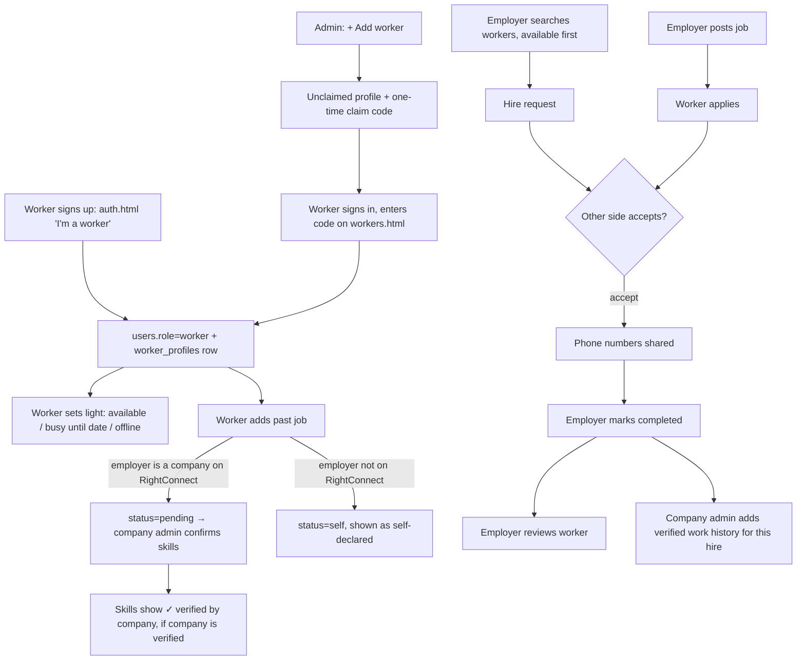

# 12. Local Workforce Hub (Workers / Service partners)

Status: 🟡 Partial (first version built; phone OTP login, location distance and payments not done)

A fourth role next to customers, experts and companies: local **workers** (also called service partners) such as cooks, drivers, sales staff, waiters, helpers and electricians. Employers (customers, experts or company admins) find nearby workers who are free now, hire them, and review them. Workers build a trusted work history: skills become **employer-verified** when a company they worked for confirms them.

## Workflow

## Rules

- **Skills and trust.** A worker's own skills are *self-declared*. A skill is **verified** only when an admin of a RightConnect-**verified** company confirms or adds a job in the worker's history that lists it. Confirmations from companies still pending RightConnect verification show as "Confirmed by X (company not yet verified)" and don't count as verified. Declined entries are hidden from the public. Company admins can't confirm their own work history. Workers can remove any entry from their own profile.
- **Availability light.** Green = available, amber = busy (optionally "free from" a date; after that date it shows green), grey = not looking. A green light not updated for 14 days is marked "not updated recently". Search lists available workers first.
- **Hires.** The side that didn't start a request accepts or declines; the starter can withdraw; either side can cancel an accepted hire; only the employer marks it completed and reviews (one review per hire). Phone/email are shared only after acceptance. Employers can hire for a company they administer, which lets that company add verified work history for the hire.
- **Jobs.** Any signed-in user can post a job (optionally as their company). Workers apply; applications appear as hires initiated by the worker. One open application per worker per job.
- **Admin-added workers.** Admins add workers (with an 18+ check) and get an 8-character claim code (30-day expiry, stored hashed, shown once). The worker signs in and enters it on the **My work profile** tab. Admins can issue a new code, block, delete and restore workers.
- **Direct contact.** Worker and job cards show **📞 Call** and **💬 WhatsApp** when the owner allows it (`show_contact`). The number is never in search results: signed-in users fetch it on tap (`GET /workers/{id}/contact`, `GET /workers/jobs/{id}/contact`), and WhatsApp opens with a ready message. Workers set their number and the switch in their work profile (new sign-ups start on and are told so; existing workers and jobs start off). Job posters choose a number and the switch when posting. Unclaimed workers can't be contacted. Migration [028](../../db/migrations/028_direct_contact.sql).
- **Pay.** Workers give one amount or a range (e.g. ₹500–1,000 per day) per hour, day or month (`rate_amount` = lower end, `rate_max` = optional upper end). Ticking *Hide my pay* (`rate_hidden`) removes the amounts from every public response; cards show "Pay: discuss" and only the worker sees the numbers. Migration [027](../../db/migrations/027_worker_pay_range.sql).
- **Safety.** Every worker confirms they are 18 or older (signup, profile creation, and admin check). Unclaimed profiles can't receive hire requests.

## Completed

- API ([workers/router.py](../../backend/app/features/workers/router.py), [service.py](../../backend/app/features/workers/service.py), [schemas.py](../../backend/app/features/workers/schemas.py)), all under `/api/v1/workers`:
  - Browse: `GET ""?q=&city=&area=&available=`, `GET /{worker_id}`, `GET /jobs?q=&city=`, `GET /companies?q=` (employer picker).
  - Worker: `GET|POST|PUT /me`, `PUT /me/availability`, `POST /me/experiences`, `DELETE /me/experiences/{id}`, `POST /claim`, `POST /jobs/{id}/apply`.
  - Employer: `POST /{worker_id}/hire`, `GET /hires`, `POST /hires/{id}/accept|decline|cancel|complete`, `POST /hires/{id}/review`, `GET /jobs/mine`, `POST /jobs`, `POST /jobs/{id}/close`.
  - Company admins: `GET /verifications`, `POST /verifications/{id}/confirm|decline`, `POST /{worker_id}/experiences`.
  - Platform admin ([admin/router.py](../../backend/app/features/admin/router.py)): `GET|POST /admin/workers`, `POST /admin/workers/{id}/claim-code|block|unblock|delete|restore`; stats include live and unclaimed workers.
- Signup: `role=worker` in `POST /auth/onboarding` (needs main work, city, `adult_confirmed`; optional `area`). Worker accounts are ready immediately (no verification queue).
- Data: [worker.py](../../backend/app/models/worker.py) (`worker_profiles`, `worker_experiences`, `worker_hires`, `worker_reviews`, `job_posts`), `user_role` value `worker`; migration [024_workforce_hub.sql](../../db/migrations/024_workforce_hub.sql).
- Frontend: [workers.html](../../frontend/pages/workers.html) (Find workers, Jobs, Hires, My work profile), worker option in [auth.html](../../frontend/pages/auth.html), "Workers & jobs" in the [marketplace](../../frontend/pages/marketplace.html) sidebar, Workers tab and "+ Add worker" in the [admin console](../../backend/admin/index.html).
- Existing accounts: the marketplace "Acting as" menu shows **+ Register as a worker** (or **Worker profile** with the availability light once created) and a **Find work** top-bar link; both open `workers.html?tab=me`. `GET /auth/identities` returns `worker_profile` (`id`, `headline`, `availability`, `location_missing`).
- Regression: `PYTHONPATH=backend python3 -B -m unittest discover -s backend/tests -p 'test_workforce_hub.py' -v`.

## Not Done / To Do

- **Phone/WhatsApp OTP login** for workers without Google accounts (needs an SMS/WhatsApp provider such as MSG91 or Twilio).
- Distance search ("within 5 km") — needs map coordinates on profiles and jobs.
- Worker photo upload (the `avatar_url` column exists; reuse the profile image helper).
- ID verification badge (Aadhaar/DigiLocker via a licensed provider), and notifications (WhatsApp/email) for new hire requests.
- Printable experience certificate from verified work history; attendance and wage payments.
- Workers appear only on `workers.html`, not in the main Discover results or the marketplace acting-as switcher.
