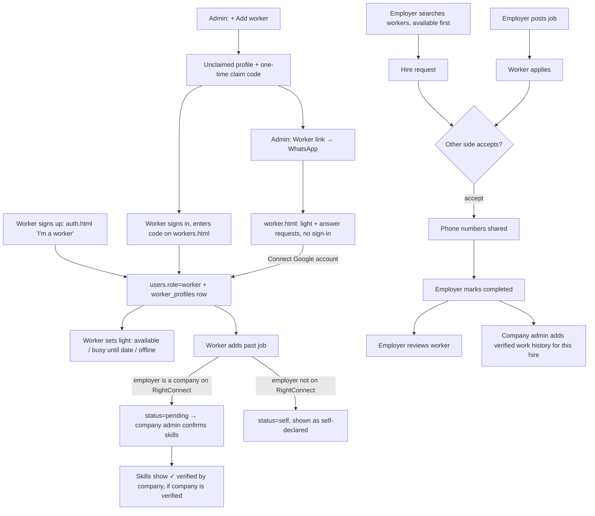

# 12. Local Workforce Hub (Workers / Service partners)

Status: 🟡 Partial (first version built; worker links for workers without sign-in done; phone OTP login, location distance and payments not done)

A fourth role next to customers, experts and companies: local **workers** (also called service partners) such as cooks, drivers, sales staff, waiters, helpers and electricians. Employers (customers, experts or company admins) find nearby workers who are free now, hire them, and review them. Workers build a trusted work history: skills become **employer-verified** when a company they worked for confirms them.

## Workflow

## Rules

- **Skills and trust.** A worker's own skills are *self-declared*. A skill is **verified** only when an admin of a RightConnect-**verified** company confirms or adds a job in the worker's history that lists it. Confirmations from companies still pending RightConnect verification show as "Confirmed by X (company not yet verified)" and don't count as verified. Declined entries are hidden from the public. Company admins can't confirm their own work history. Workers can remove any entry from their own profile.
- **Availability light.** Green = available, amber = busy (optionally "free from" a date; after that date it shows green), grey = not looking. A green light not updated for 14 days is marked "not updated recently". Search lists available workers first.
- **Hires.** The side that didn't start a request accepts or declines; the starter can withdraw; either side can cancel an accepted hire; only the employer marks it completed and reviews (one review per hire). Phone/email are shared only after acceptance. Employers can hire for a company they administer, which lets that company add verified work history for the hire.
- **Jobs.** Any signed-in user can post a job (optionally as their company). Workers apply; applications appear as hires initiated by the worker. One open application per worker per job.
- **Admin-added workers.** Admins add workers (with an 18+ check) and get an 8-character claim code (30-day expiry, stored hashed, shown once). The worker signs in and enters it on the **My work profile** tab. Admins can issue a new code, block, delete and restore workers.
- **Direct contact (View contact).** Worker cards show **📇 View contact** when the worker allows it (`show_contact`). The number is never in search results: a signed-in user taps the button (`POST /workers/{id}/contact`) and gets the phone (tap to call), a WhatsApp link with a ready message and the email. Self-signed workers use their account phone/email unless they set another number, and can switch sharing off in their work profile; employers then send a hire request and the number is shared once the worker accepts. Admin-added workers use the phone/email the admin collected (the *they agreed* box is on by default). Busy workers stay contactable. Job cards use the same button (`GET /workers/jobs/{id}/contact`, no limit). Migrations [028](../../db/migrations/028_direct_contact.sql), [030](../../db/migrations/030_worker_contact_views.sql).
- **Contact log and daily limit.** Every View contact is logged in `worker_contact_views` (one row per worker and viewer, with view count). Opening a **new** worker counts toward the viewer's daily limit, which resets at midnight India time: Free 10, Pro (active expert plan) 20, Enterprise (active company plan) 30; platform admins have no limit and the worker's own profile isn't counted. Re-opening a worker already viewed is free. Over the limit the API answers 429 with a link to Plans. Limits live in `CONTACT_DAILY_LIMIT` ([plans.py](../../backend/app/core/plans.py)).
- **Who viewed my number and reports.** Workers see who opened their number (name, company, date, how many times) on **My work profile** and on their link page, and can **Report** with one tap (calls too many times, rude or abusive, not about work). Admins see reports under Workers → **Reported callers**, with **Block this account** or **Dismiss**.
- **Pay.** Workers give one amount or a range (e.g. ₹500–1,000 per day) per hour, day or month (`rate_amount` = lower end, `rate_max` = optional upper end). Ticking *Hide my pay* (`rate_hidden`) removes the amounts from every public response; cards show "Pay: discuss" and only the worker sees the numbers. Migration [027](../../db/migrations/027_worker_pay_range.sql).
- **Worker links (no sign-in).** For workers who can't use Google or email, an admin creates a personal link (`/pages/worker.html#k=…`) and sends it on WhatsApp. With it the worker sets their light and accepts or declines hire requests; once a request is accepted they see the employer's number. The key is random (`secrets.token_urlsafe`), stored only as a SHA-256 hash, carried in the URL fragment and the `X-Worker-Key` header (never in server logs), and shown once. **Reset link** replaces it; **Turn off link** removes it. A worker with a link counts as reachable: no "Unclaimed" badge, and they can receive hires and Call/WhatsApp.
- **One identity.** If a link worker later signs in with Google/email, **Connect Google account** on their page (or sign-up from it) attaches the same profile to the account; no second worker profile is made, and the link keeps working. It refuses if the account already has a worker profile or the profile belongs to another account. If the worker signs up on their own instead, a second profile is created and the admin list flags **possible duplicate** (same phone). Under Workers → **To merge**, an admin-made profile whose phone matches exactly one worker account shows **Merge into account**: its hires, reviews, work history, contact log and link move into the account's profile, empty fields are filled (the worker's own entries win, skills and languages are combined, ratings are re-averaged) and the copy is deleted. Merging is admin-only and needs the phones to match (`POST /admin/workers/{id}/merge`); profiles are never merged automatically, because phone numbers aren't verified yet.
- **Safety.** Every worker confirms they are 18 or older (signup, profile creation, and admin check). Unclaimed profiles can't receive hire requests.

## Completed

- API ([workers/router.py](../../backend/app/features/workers/router.py), [service.py](../../backend/app/features/workers/service.py), [schemas.py](../../backend/app/features/workers/schemas.py)), all under `/api/v1/workers`:
  - Browse: `GET ""?q=&city=&area=&available=`, `GET /{worker_id}`, `GET /jobs?q=&city=`, `GET /companies?q=` (employer picker).
  - Worker: `GET|POST|PUT /me`, `PUT /me/availability`, `POST /me/experiences`, `DELETE /me/experiences/{id}`, `POST /claim`, `POST /jobs/{id}/apply`.
  - Employer: `POST /{worker_id}/hire`, `GET /hires`, `POST /hires/{id}/accept|decline|cancel|complete`, `POST /hires/{id}/review`, `GET /jobs/mine`, `POST /jobs`, `POST /jobs/{id}/close`.
  - Company admins: `GET /verifications`, `POST /verifications/{id}/confirm|decline`, `POST /{worker_id}/experiences`.
  - Contact: `POST /{worker_id}/contact` (logged, daily limit), `GET /me/contact-views`, `POST /me/contact-views/{id}/report`.
  - Worker link (header `X-Worker-Key`): `GET /link/me` (includes `contact_views`), `PUT /link/me/availability`, `POST /link/me/hires/{id}/accept|decline|cancel`, `POST /link/me/contact-views/{id}/report`, `POST /link/connect` (also needs sign-in).
  - Platform admin ([admin/router.py](../../backend/app/features/admin/router.py)): `GET|POST /admin/workers` (`status=duplicates` lists profiles sharing a phone), `POST /admin/workers/{id}/claim-code|block|unblock|delete|restore|merge`, `POST|DELETE /admin/workers/{id}/access-link`, `GET /admin/contact-reports`, `POST /admin/contact-reports/{id}/dismiss`; stats include live and unclaimed workers.
- Signup: `role=worker` in `POST /auth/onboarding` (needs main work, city, `adult_confirmed`; optional `area`). Worker accounts are ready immediately (no verification queue).
- Data: [worker.py](../../backend/app/models/worker.py) (`worker_profiles`, `worker_experiences`, `worker_hires`, `worker_reviews`, `job_posts`), `user_role` value `worker`; migration [024_workforce_hub.sql](../../db/migrations/024_workforce_hub.sql).
- Frontend: [workers.html](../../frontend/pages/workers.html) (Find workers, Jobs, Hires, My work profile), worker option in [auth.html](../../frontend/pages/auth.html), "Workers & jobs" in the [marketplace](../../frontend/pages/marketplace.html) sidebar, Workers tab and "+ Add worker" in the [admin console](../../backend/admin/index.html).
- Worker link page: [worker.html](../../frontend/pages/worker.html); admin console Workers tab has **Worker link / Reset link / Turn off link**, "link on" and "possible duplicate" badges. Migration [029_worker_links.sql](../../db/migrations/029_worker_links.sql).
- Contact log, limits, reports and merge: `worker_contact_views` table and `worker_profiles.contact_email` (migration [030_worker_contact_views.sql](../../db/migrations/030_worker_contact_views.sql)); admin Workers filters **To merge** and **Reported callers**; email field on **+ Add worker**; worker contact limits listed on [plans.html](../../frontend/pages/plans.html).
- Existing accounts: the marketplace "Acting as" menu shows **+ Register as a worker** (or **Worker profile** with the availability light once created) and a **Find work** top-bar link; both open `workers.html?tab=me`. `GET /auth/identities` returns `worker_profile` (`id`, `headline`, `availability`, `location_missing`).
- Regression: `PYTHONPATH=backend python3 -B -m unittest discover -s backend/tests -p 'test_workforce_hub.py' -v`.

## Not Done / To Do

- **Automatic merge** when a new worker account's phone matches an admin-made profile, once phone numbers are OTP-verified (until then admins merge).
- A separate paid "hiring pass" for customers (e.g. hotel owners) who need more than 10 worker contacts a day without buying Pro or Enterprise.
- **Phone/WhatsApp OTP login** as a step up from worker links (needs an SMS/WhatsApp provider such as MSG91, Twilio or the WhatsApp Business API, plus DLT registration for Indian SMS).
- Worker link page in Tamil/Hindi and other languages (English only today).
- Distance search ("within 5 km") — needs map coordinates on profiles and jobs.
- Worker photo upload (the `avatar_url` column exists; reuse the profile image helper).
- ID verification badge (Aadhaar/DigiLocker via a licensed provider), and notifications (WhatsApp/email) for new hire requests.
- Printable experience certificate from verified work history; attendance and wage payments.
- Workers appear only on `workers.html`, not in the main Discover results or the marketplace acting-as switcher.
