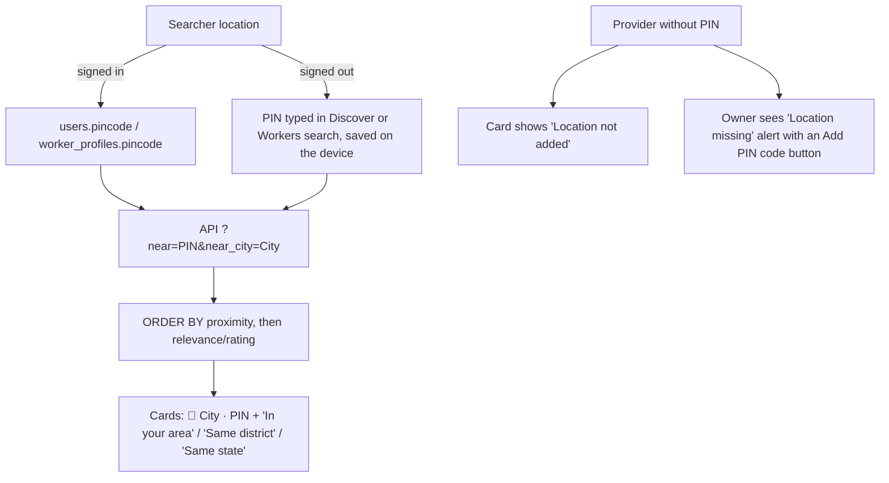

# 13. Location: nearest first across India

Status: 🟡 Partial (PIN code ranking done; GPS/distance in km not done)

RightConnect works all over India, so every list shows people near the searcher first. Location is a 6-digit India Post **PIN code** (plus city/area text for display).

## How nearness is ranked

PIN codes are hierarchical, so nearness is ranked without maps or third-party services ([location.py](../../backend/app/core/location.py)):

| Score | Meaning | Rule |
|---|---|---|
| 4 | In your area | Same 6 digits |
| 3 | Same district | Same first 3 digits (sorting district), or same city name when a profile has no PIN |
| 2 | Same state | First 2 digits in the same postal circle (e.g. Tamil Nadu = 60–66; table in `STATE_BY_PREFIX`) |
| 1 | Nearby region | Same first digit (neighbouring states) |
| 0 | Far from you | Anything else, including profiles with no location |

Location is a **preference, not a filter**: everyone matching the search still appears, nearest first, then by search match and rating. Workers rank by distance before the availability light. Circle borders are approximate (e.g. Goa uses Maharashtra's 40x range).

## Workflow

## Completed

- Data: `pincode` on `users`, `profiles`, `worker_profiles`, `job_posts` with a `^[1-9][0-9]{5}$` check; migration [025_location_pincodes.sql](../../db/migrations/025_location_pincodes.sql).
- API: `near` (PIN) and `near_city` on `GET /api/v1/profiles`, `/showcases`, `/workers`, `/workers/jobs`; results carry `nearness` (0–4). `pincode` is editable via `PATCH /auth/me`, `PATCH /profiles/{id}`, `/workers/me`, job posts, signup, add-expert/add-company, and admin add business/worker.
- Signup ([auth.html](../../frontend/pages/auth.html)): PIN required for experts, companies and workers; optional (skippable) for customers.
- Discover ([marketplace.html](../../frontend/pages/marketplace.html)): "📍 Your PIN code" box in the search bar (saved to the account when signed in, else on the device); 📍 line and near badge on every card; "Location not added" for missing ones; alert asking providers whose expert/company listing has no PIN to add it (opens the profile editor); video sidebar also nearest first.
- Workers ([workers.html](../../frontend/pages/workers.html)): PIN box in worker and job search, 📍 on worker and job cards, PIN required in profile and job forms, warning when a worker's PIN is missing.
- Shared helper: [location.js](../../frontend/assets/location.js).
- Regression: `PYTHONPATH=backend python3 -B -m unittest discover -s backend/tests -p 'test_location.py' -v`.

## Not Done / To Do

- Distance in km and "within X km" filters: needs latitude/longitude per PIN (e.g. the India Post PIN code directory on data.gov.in, Open Government Data Licence) or browser GPS.
- Auto-fill city/state from the PIN code (same dataset).
- Backfill: existing profiles have no PIN until owners add one (the alert and "Location not added" label prompt them).
